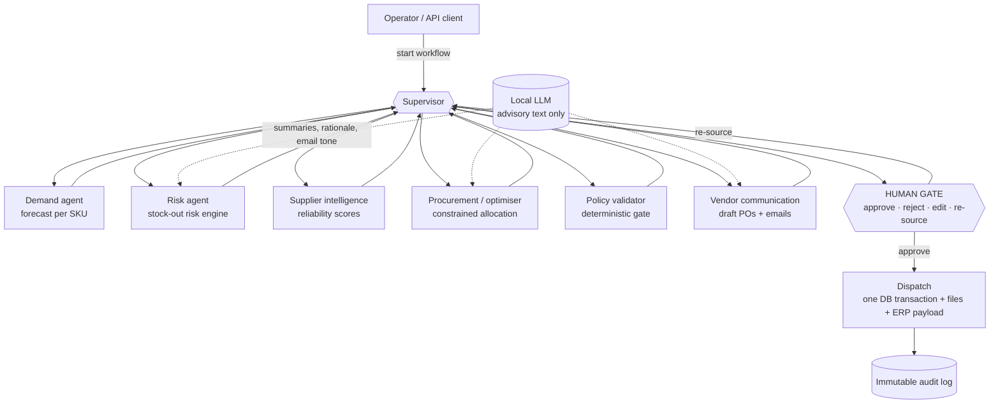

# Autonomous Supply Chain & Operations Engine

A multi-agent system that watches inventory, **forecasts demand**, **quantifies stock-out risk**, **scores suppliers**, **optimises purchase allocations under real constraints**, drafts purchase orders and then **stops for a human decision** before anything is dispatched.

> **AI provides intelligence, deterministic systems provide control, and humans retain authority over consequential decisions.**

LangGraph orchestrates the agents · a local Ollama model (`llama3.2`) writes advisory text · deterministic engines make every number-bearing decision · SQLite stores state, history and an immutable audit trail · FastAPI + Streamlit expose it.

---

## Enterprise platform layer (multi-tenant, measurable, integratable)

On top of the engine below there is a multi-tenant platform: tenant isolation and RBAC, business-impact measurement with documented methodology, a what-if simulator, ROI with explicit assumptions, data import with validation, tiered approvals, a versioned REST API (OpenAPI), signed webhooks, an ERP adapter interface, usage metering, privacy controls, backup / restore and a production-readiness check.

**Status labels** - **IMPLEMENTED** code exists · **VALIDATED** implemented and covered by tests / measurements that were run · **SIMULATED** exercised only on synthetic data or mocks · **ADAPTER-READY** an interface exists, no connector · **FUTURE** not built. Per-capability table: [docs/COMMERCIAL_READINESS.md](docs/COMMERCIAL_READINESS.md). Limits and what is *not* claimed: [docs/product/LIMITATIONS.md](docs/product/LIMITATIONS.md).

> All business results are on **synthetic** data. No customer has used this. The ERP is a **mock**; no SAP / Oracle / Dynamics / NetSuite connector exists.

| Command | What it does |
|---|---|
| `make install` | install dependencies |
| `make dev` / `make ui` | API with reload on :8000 / console on :8501 |
| `make demo` | end-to-end demo on synthetic data (onboarding -> before/after -> approval -> mock ERP -> trace -> ROI -> reports) |
| `make test` | test suite without the slow QA matrix (`make test-all` includes it) |
| `make evaluate` | 114-scenario benchmark, 20-run pre-registered business experiment, synthetic case studies |
| `make security-test` | injection, traversal, RBAC, tenant isolation, SSRF, webhook forgery / replay, abuse limits |
| `make load-test` | 10 / 50 / 100 concurrent workflows over real HTTP -> [docs/LOAD_TEST_REPORT.md](docs/LOAD_TEST_REPORT.md) |
| `make chaos-test` | engine fault matrix + 12 platform failure scenarios -> [docs/FAILURE_TEST_REPORT.md](docs/FAILURE_TEST_REPORT.md) |
| `make production-check` | PASS / WARNING / FAIL for configuration, data and evidence |
| `make production` | hardened local launcher (needs `SCM_SECRET_KEY`); not a deployment |

Product documentation: [docs/product/](docs/product/) - PRODUCT_OVERVIEW, CUSTOMER_ONBOARDING, INTEGRATION_GUIDE, API_GUIDE (+ real captured [API_EXAMPLES](docs/product/API_EXAMPLES.md)), SECURITY, RBAC, BUSINESS_METRICS, ROI_METHODOLOGY, DEMO_GUIDE, OPERATIONS, LIMITATIONS. Architecture diagram: [docs/ARCHITECTURE.md](docs/ARCHITECTURE.md) section 11.

---

## 1. Problem and why it matters

Replenishment is the classic "looks easy, fails expensively" workflow. A fixed reorder point reacts only *after* stock is already low, a price-only supplier choice ignores lead time, quality, minimum order quantities and capacity, and a language model that is allowed to "just decide" will eventually hallucinate a supplier or a price. Every failure here costs real money: a stock-out loses sales, an over-order ties up cash, a wrong or duplicated purchase order is hard to undo.

This project shows how to use an LLM **where it is good** (explaining, summarising, writing the email) and keep it **out of every decision that has a number in it**.

## 2. Architecture



Every worker reports back to the supervisor; the supervisor routes on `stage`. The graph is compiled with `interrupt_before=["vendor_dispatch"]`, so execution is **physically paused** at the human gate and resumes only when a decision is written into the checkpoint.

### Agent responsibilities

| Agent (graph node) | Decides | Uses the LLM for |
|---|---|---|
| **Supervisor** | routing only | nothing |
| **Demand** (`demand`) | best forecasting model per SKU (by backtest), persists forecasts + MAE/RMSE/MAPE | nothing |
| **Risk** (`analytics`) | days of cover, P(stock-out), safety stock, reorder quantity, risk level (rules + maths) | one-paragraph narrative of the numbers |
| **Supplier Intelligence** (`supplier_intel`) | reliability score from delivery history | nothing |
| **Procurement** (`procurement`) | allocation across suppliers (exact optimiser; deterministic fallback) | rationale text for a decision already made |
| **Policy** (`policy_check`) | blocks impossible/unsafe lines (unknown SKU, absurd price, MOQ, capacity, duplicates ...) | nothing |
| **Vendor Comms** (`vendor_comm`) | creates the POs idempotently in one transaction | the tone of the email (intro / closing) |
| **Human gate / Dispatch** (`vendor_dispatch`) | **a person** approves; dispatch re-validates policy, then commits atomically | nothing |

### Data flow

1. `Demand` reads `demand_history`, forecasts, writes `forecasts`, emits `DemandForecastUpdated`.
2. `Risk` combines forecast + lead time + variability + open orders into a `RiskAssessment` per SKU (predictive alerts fire even when stock is above the static reorder point).
3. `Supplier Intel` turns `supplier_deliveries` into scores (`supplier_metrics`).
4. `Procurement` builds `SupplierOption`s from quotes + scores + MOQ/capacity/region and calls `SupplierOptimizer`.
5. `Policy` re-derives everything from the database and drops any line that violates a rule.
6. `Vendor Comms` creates `purchase_orders` (+ `purchase_requests` idempotency rows + audit rows) in **one transaction**.
7. **Pause.** A human approves / rejects / edits / re-sources.
8. `Dispatch` re-validates policy against *current* data, then in one transaction marks the POs `SENT`, receives stock and writes the audit event; files are staged and promoted only after the commit.

## 3. Human-in-the-loop

The approval screen (console) and `GET /api/v1/workflows/{id}` (API) show, per line: SKU, quantity, supplier, unit price, total, lead time, **risk level, days of cover, forecast confidence, supplier score, share of the order, expected savings, policy flags and the reasoning**. Actions: **Approve · Reject · Edit (email text in the console, quantity via the API, re-validated by policy) · Re-source** (rejected suppliers are excluded; bounded to 2 rounds). Every decision is audited with *who, when, what, previous value, new value, reason*.

## 4. Safety boundaries

```
LLM → structured proposal → schema validation → deterministic policy → optimisation engine
    → risk validation → human approval → execution → audit log
```

* The LLM only produces **advisory text** through strict pydantic schemas (`DemandAnalysis`, `RiskExplanation`, `ProcurementRecommendation`, `VendorMessage`). If a model emits decision-style fields (`selected_vendor`, `unit_price_usd`, `approve` ...) they are discarded, reported and audited, never read.
* Vendor / item text is **untrusted**: sanitised, injection phrases neutralised, wrapped in `<untrusted_data>` and the system prompt says so. Even a perfect injection could only change *wording*, because no decision reads model output.
* Policy runs twice: before the human sees the proposal **and** again at approval time (catching stale prices etc.).
* No irreversible action without a human decision; all irreversible steps are transactional and idempotent.

## 5. Forecasting

`DemandForecaster` backtests several models on a holdout and keeps the best by RMSE: moving average, weighted moving average, exponential smoothing, Holt trend (damped), seasonal baseline (needs ≥ 2 seasons). It returns the forecast curve, expected demand, **confidence** (`(1 − WAPE) × min(1, history/56d)`), the chosen method and error metrics. **MAPE is reported only where it is mathematically valid** (non-zero actuals, not intermittent demand); WAPE is always defined. Interface: `forecast(sku_id, historical_demand, horizon_days)`; new models plug in via `Model.predict`.

## 6. Risk engine (no LLM)

Lead-time demand ~ N(μ_L, σ_L) with σ_L² = L·σ_d² + d²·σ_LT². Outputs `days_until_stockout`, `stockout_probability`, `safety_stock`, dynamic reorder point, `recommended_order_quantity` and `risk_level` (LOW / MEDIUM / HIGH / CRITICAL) from configurable probability thresholds. SKUs without history fall back to the legacy static rule.

## 7. Supplier optimisation

Minimise `purchase + stock-out exposure + lead-time + supplier-risk (+ fixed cost per supplier)` subject to required quantity, per-supplier capacity, MOQ for selected suppliers, quality/reliability floors, allowed regions, optional budget and a diversification cap (default 70 % per supplier for large orders). Because every term is linear, the optimum for a fixed supplier set is a greedy fill; the supplier *set* is chosen by exhaustive enumeration (≤ 2⁸ subsets), so the result is exact. A deterministic cheapest-valid-quote fallback exists. See `docs/AI_SYSTEM_DESIGN.md` for the maths and `docs/EVALUATION_REPORT.md` for measured behaviour (including the cost of diversification).

## 8. Fault tolerance

Timeouts, bounded retries with exponential backoff (+ deterministic jitter), per-model circuit breakers (closed → open → half-open), a shared deadline per call, model fallback (`primary → secondary → fallback`), then deterministic fallbacks in every agent. Node exceptions are contained (`safe_node`) and pending orders are rolled back. 128-case QA matrix + 114 evaluation scenarios + `make chaos-test`.

## 9. Evaluation

`python -m evaluation.runner benchmark --live-llm 3 --report docs/EVALUATION_REPORT.md` runs **114 deterministic scenarios** (normal, high demand, low inventory, supplier failure, LLM failure, DB/network failure, malicious input, multi-supplier, adversarial) plus forecasting, stock-out-prediction, optimiser and inventory-simulation studies, and a live sample against the real local model. Every scenario also asserts universal safety invariants. All numbers in the report come from that run.

## 10. Observability

Every node is a **span** (`node_runs`): trace id, workflow id, run id, agent, node, timestamp, duration, status, error, model, tokens, estimated cost. Every LLM call is a row in `llm_calls` (latency, tokens, retries, fallback). Logs are structured JSON with secret redaction. `GET /api/v1/metrics` exposes P50/P95/P99 per node, LLM totals and workflow success rate.

## 11. Security

API keys (stored only as SHA-256 hashes), roles `ADMIN / APPROVER / OPERATOR / VIEWER`, input validation everywhere, parameterised SQL, path-traversal guards, prompt-injection defence, append-only hash-chained audit log, secrets never logged. See `docs/THREAT_MODEL.md`.

## 12. Deployment

`Dockerfile`, `docker-compose.yml` (API + console + optional Ollama), `.env.example`, health (`/health`) and readiness (`/ready`) endpoints, versioned migrations. See `docs/DEPLOYMENT.md`. *The Docker files were written and linted but not built in this environment (no Docker available).*

## 13. Running locally

```powershell
python -m venv .venv
.venv\Scripts\python -m pip install -r requirements-dev.txt
ollama pull llama3.2                      # optional: the engines work without any LLM

# console (Streamlit, 4 pages: Product · Operations Centre · Provisioning · Executive)
.venv\Scripts\python -m streamlit run app.py

# HTTP API
.venv\Scripts\python -m scm.security gen-key --role ADMIN --actor me      # prints the key once + the SCM_API_KEYS entry
$env:SCM_API_KEYS = "<paste entry>"
.venv\Scripts\python -m uvicorn api.main:app --port 8000                  # docs at /docs
```

Everything is also available as `make` targets (`make install test lint typecheck eval chaos-test api ui`).

## 14. Testing

```powershell
.venv\Scripts\python -m pytest                       # 286 tests incl. the 128-case QA matrix (~2 min)
.venv\Scripts\python -m pytest -m "not slow"         # without the QA matrix
.venv\Scripts\python -m ruff check . ; .venv\Scripts\python -m mypy
.venv\Scripts\python -m evaluation.runner chaos      # fault-injection table
```

Pyramid: unit (forecast, risk, optimiser incl. brute-force verification and 300 randomised constraint checks, policy, suppliers, security, settings) · integration (DB, migrations, idempotency, audit, events) · workflow (LangGraph end-to-end, faults, crashes) · API (auth/RBAC/idempotency/validation) · adversarial (injection, tampering) · contract (graph topology, schemas, API shapes, DB columns) · UI (Streamlit `AppTest`) · evaluation/chaos.

## 15. Example workflow

```bash
curl -X POST localhost:8000/api/v1/workflows -H "X-API-Key: $KEY" -H "Idempotency-Key: nightly-2026-10-01"   # 202, runs in a worker
curl localhost:8000/api/v1/workflows/<id> -H "X-API-Key: $KEY"        # status AWAITING_APPROVAL + proposals, risk, reasoning
curl -X POST localhost:8000/api/v1/workflows/<id>/approve -H "X-API-Key: $APPROVER_KEY" \
     -H "Content-Type: application/json" -d '{"reason": "checked with finance"}'
curl "localhost:8000/api/v1/audit?workflow_id=<id>&verify=true" -H "X-API-Key: $KEY"    # full trail + hash-chain verification
```

---

## Repository layout

```
app.py · ui/ · views/ · assets/   Streamlit console (Product, Operations Centre, Provisioning, Executive)
api/main.py                       FastAPI app (thin: auth, validation, error mapping)
scm/                              the engine
  graph.py                          LangGraph agents + supervisor + human gate
  forecast.py risk.py suppliers.py optimizer.py policy.py     deterministic decision engines
  llm.py llm_router.py schemas.py                             LLM boundary: routing, resilience, strict schemas
  services.py orders.py audit.py events.py                   workflow service, idempotent/transactional orders, audit, events
  security.py obs.py settings.py                              RBAC/injection defence, observability, configuration
  db.py migrations.py seed.py dashboard.py ingest.py qa.py    persistence, migrations, demo data, read models, data ingest, QA matrix
evaluation/                       datasets · scenarios · evaluators · metrics · reports · runner
tests/                            pytest suite       docs/  architecture, design, threat model, ops, report
```

Documentation: `docs/ARCHITECTURE.md` · `docs/AI_SYSTEM_DESIGN.md` · `docs/THREAT_MODEL.md` · `docs/EVALUATION.md` · `docs/EVALUATION_REPORT.md` · `docs/OPERATIONS.md` · `docs/DEPLOYMENT.md` · `docs/DECISION_LOG.md` · `docs/PRODUCTION_READINESS.md`.
