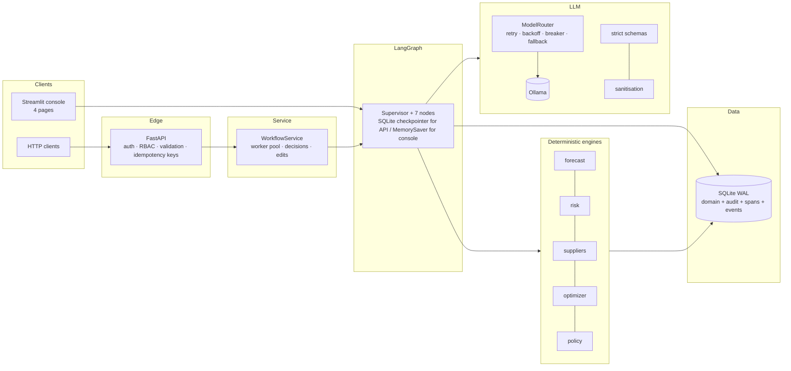
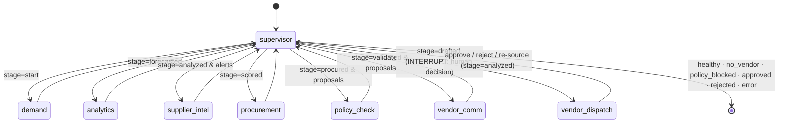
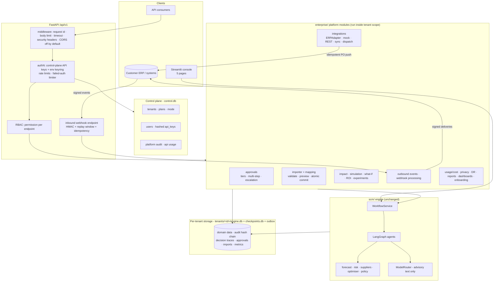

# Architecture

## 1. Audit of the starting point (what existed before this upgrade)

| Area | State before |
|---|---|
| Entry points | One Streamlit app (4 pages after a UI refactor); no HTTP API, no worker |
| Agents / graph | `Supervisor → Analytics → Procurement → Vendor Comms → [human gate] → Dispatch` (LangGraph, `MemorySaver`, `interrupt_before` the dispatch node) |
| Decisions | Analytics: static `stock < reorder point`. Procurement: **lowest unit price wins**. Quantity = `ceil((target − stock)/5)·5` |
| LLM | Ollama via LangChain; JSON → repair → regex salvage → template fallback; run-level circuit breaker; fault-injection hooks |
| Data | SQLite (`inventory`, `vendors`, `vendor_listings`, `purchase_orders`, `app_state`), WAL, always-closed connections; no history, no migrations, no foreign keys |
| QA | 125-case matrix (DB scenario × LLM fault × node crash) run from the UI; no `tests/` directory, no CI |
| Security | none (single local user); no audit trail beyond the in-memory trace |
| Observability | in-memory trace + token telemetry shown in the UI |
| Deployment | `streamlit run`; no container, no health checks, no config files |

### Gaps identified

1. **Reactive** inventory logic; no demand history, forecast or probabilistic risk.
2. **Price-only** supplier choice (ignores lead time, reliability, quality, MOQ, capacity); single supplier per item.
3. LLM output validated by ad-hoc dict checks; no schema; decision fields in model output not explicitly excluded.
4. **No idempotency** (a retried step could create duplicate POs) and PO creation / approval not atomic.
5. No immutable audit log; no who/when/previous/new value for human decisions.
6. No authentication, RBAC, input-validation layer or prompt-injection defence for third-party text.
7. No API, no background worker; long LLM workflows blocked the UI thread.
8. No structured logs, trace ids, persisted spans or cost accounting.
9. No automated evaluation beyond the QA matrix; no unit/integration/API/contract tests.
10. No migrations, indexes, foreign keys or CHECK constraints.

All ten are addressed below (see `PRODUCTION_READINESS.md` for the honest status of each).

## 2. Current architecture



### Layers and dependency rule

`api/` → `scm.services` → `scm.graph` → { engines, `scm.llm*`, `scm.orders`, `scm.audit` } → `scm.db`. Engines (`forecast`, `risk`, `suppliers`, `optimizer`, `policy`) are pure functions over plain data (suppliers/forecast/policy also have thin persistence helpers). **No engine imports the LLM layer; the LLM layer imports no engine.** The graph is the only place where they meet, which keeps the "LLM proposes, engines decide" boundary auditable by grep.

## 3. State model

`SupplyState` (a `TypedDict`, merged by LangGraph reducers where a key is `Annotated[..., add]`):

| Key | Written by | Meaning |
|---|---|---|
| `stage` | every worker | `start → forecasted → analyzed → scored → procured → validated → drafted → dispatched` (or `failed`) |
| `alerts` | risk | per-SKU findings incl. `risk_level`, `days_until_stockout`, `stockout_probability`, `rec_qty`, `basis` (`forecast`/`static_rule`), `predictive` |
| `proposals` | procurement → policy | one line per (SKU, supplier) allocation with price, qty, share, scores, `policy_flags` |
| `drafts` | vendor comm | per-vendor email + PO ids (editable by the human) |
| `decision`, `approver`, `decision_reason` | the human (via `update_state`) | `approve / reject / resource` + identity + reason |
| `policy`, `forecast_summary`, `supplier_scores` | policy / demand / supplier_intel | compact summaries (full series live in the DB) |
| `trace`, `telemetry`, `errors`, `human_choices` | all | append-only logs |
| `workflow_id`, `trace_id`, `rounds`, `excluded`, `status`, `outcome`, `llm_ok`, `next` | supervisor / dispatch | control + result |

## 4. LangGraph topology



*Deviation from the sketch in the brief:* vendor emails are drafted **before** the human gate (not after), because reviewers edit the email and see the exact ERP payload. Nothing is sent before approval, so the safety property is identical; this is recorded in `DECISION_LOG.md`.

## 5. Persistence

* **Console** keeps a `MemorySaver` shared across Streamlit sessions plus a pointer in `app_state` so a refreshed tab re-attaches to a paused run.
* **API / worker** use `SqliteSaver` (`SCM_CHECKPOINT_DB`): a paused workflow survives a process restart (tested: `test_durable_checkpoints_survive_a_service_restart`).
* Business data, audit log, spans, LLM calls and the domain-event outbox are in the main SQLite DB.

### Schema (migration v2 adds everything below the line)

```
inventory(Item_ID PK, ...)   vendors(Vendor_ID PK, ..., Region)   vendor_listings(Vendor_ID, Item_ID, Unit_Price, Lead_Time_Days, MOQ, Capacity)
purchase_orders(PO_ID PK, ..., Workflow_ID, Idempotency_Key UNIQUE-when-not-null)   app_state   access_requests
------------------------------------------------------------------------------------------------------------------------------
demand_history(Item_ID FK→inventory CASCADE, Day, Quantity ≥ 0)                      forecasts(Workflow_ID, Item_ID, Method, Horizon, Expected, Confidence ∈[0,1], MAE, RMSE, MAPE)
supplier_deliveries(Vendor_ID FK, ..., Qty_Ordered > 0, Unit_Price > 0, Status ∈ {DELIVERED, CANCELLED})   supplier_metrics(Vendor_ID PK FK, ..., Reliability_Score, Source)
purchase_requests(Idempotency_Key UNIQUE, PO_ID)                                     audit_events(append-only, hash-chained; UPDATE/DELETE blocked by triggers)
workflow_runs(Workflow_ID PK, Idempotency_Key UNIQUE, Status, ...)                   node_runs(span per node)   llm_calls   domain_events(outbox)   schema_migrations
```

Foreign keys are enforced (`PRAGMA foreign_keys=ON` on every connection) for the new tables; legacy tables could not gain FKs without a rebuild (see decision log). Indexes cover every hot query (`ix_po_status`, `ix_listings_item`, `ix_audit_wf`, `ix_spans_wf`, ...).

## 6. LLM boundaries

| LLM may | LLM may not |
|---|---|
| summarise risk, explain a decision, write the email intro/closing | choose a supplier, set or change a price/quantity/total |
| extract structure from messy text (schema-validated) | approve, authorise, bypass policy, change DB permissions |
| | trigger dispatch |

Enforcement: schemas contain no decision fields; `DECISION_FIELDS` in model output are ignored + audited; decisions come from engines whose inputs are database rows; the policy validator re-derives prices/limits from the DB; dispatch needs a human.

## 7. Failure handling

| Failure | Handling |
|---|---|
| LLM timeout / error / malformed / hallucinated | bounded retry+backoff → model fallback → parse/repair → regex salvage → deterministic template; warning in the audit trail; run continues |
| Node exception | `safe_node` records the error, rolls back pending POs, audits `WORKFLOW_FAILED`, ends safely |
| Optimiser exception | deterministic cheapest-valid-quote fallback, flagged `OPTIMIZER_FALLBACK` for the human |
| Dispatch DB failure | one transaction → nothing committed; staged files discarded; `DISPATCH_FAILED` audited; orders stay pending → rolled back |
| Duplicate request / replay | idempotency keys at API (`Idempotency-Key`), at order level (`purchase_requests`), and at approval (re-approve returns the existing result; stock is never received twice) |
| Stale data at approval | policy re-validation → `policy_blocked`, POs rejected |
| Process restart | durable checkpoints (API); console re-attach pointer |

## 8. Human-in-the-loop flow

`vendor_comm` → graph interrupts before `vendor_dispatch` → human (console button or `POST /approve|reject|resource`) → `update_state(decision, approver, reason, edits)` → resume → dispatch node: audit edits → re-validate policy → atomic commit → promote files → webhook → events.

## 9. QA architecture

`scm/qa.py` (128-case matrix, throwaway DB) · `tests/` (pytest pyramid) · `evaluation/` (114 scenarios + invariants + studies) · `make chaos-test`.

## 10. Security boundaries

Edge (API keys, RBAC, validation) → service (permission checks again) → graph (policy) → DB (constraints, triggers). Third-party text is untrusted at the LLM boundary. Details: `THREAT_MODEL.md`.

---

## 11. Enterprise platform architecture (multi-tenant layer)

Added on top of the engine above. Dependency rule: `api/` → `enterprise/*` → `scm/*`; **`scm` never imports `enterprise`** (the approval chain, ERP dispatch and decision-trace capture attach through the `GATE_HOOKS` / `DONE_HOOKS` seams in `scm.services`).



**Tenant scope.** `tenancy.scope(tenant_id)` binds, for the current thread, the tenant's database path, the logging context and the tenant's effective settings (platform defaults < tenant policy < platform bounds). Worker threads must be started with `db.propagate(fn)`. Isolation is by database file; every row is additionally stamped with `Tenant_ID` and filtered by it, so a routing bug cannot silently mix tenants.

**Where decisions are made.** Unchanged: deterministic engines decide, the policy validator gates, a human approves (now through a tiered chain), the LLM only drafts text. The platform layer adds *measurement* (impact, simulation), *control* (policies, approvals, RBAC) and *connection* (API, webhooks, ERP adapters); it does not add model-made decisions.

**Status of each box**: see the table in [COMMERCIAL_READINESS.md](COMMERCIAL_READINESS.md).
